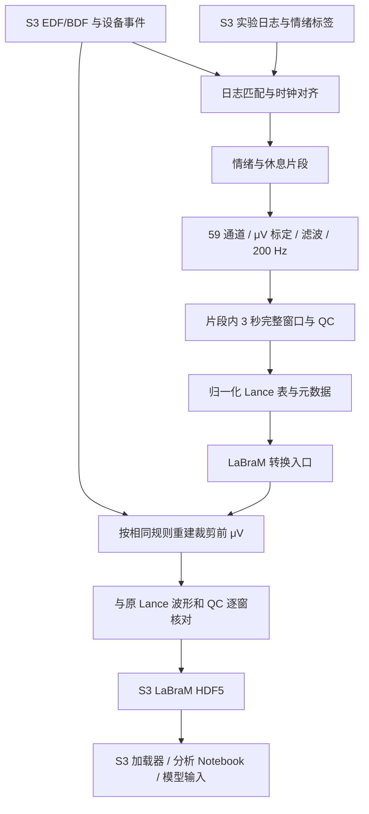

# personalized_FM_OMNI

用于 EEG 基础模型个体化适配、静息态重建与下游分类实验的研究代码仓库。目前包含 EMOVID 原始数据预处理、面向 LaBraM 的数据转换与 S3 读取，以及 LaBraM、CBraMod、BIOT 等模型的训练和评估代码。

当前可以从头运行的 EMOVID 数据链路为：**S3 原始 EEG 与事件日志 → 通用预处理及质控 → Lance 数据集 → LaBraM HDF5 → S3 数据加载与分析**。历史训练入口主要使用 M3CV、CogBCI 等实验数据，需要根据实际数据、权重和实验配置设置参数。

仓库地址：<https://github.com/UnonoU/personalized_FM_OMNI>

## 目录

- [主要功能](#主要功能)
- [项目结构](#项目结构)
- [环境准备](#环境准备)
- [快速开始](#快速开始)
- [通用 EMOVID 预处理](#通用-emovid-预处理)
- [LaBraM 转换与模型接口](#labram-转换与模型接口)
- [Notebook 分析](#notebook-分析)
- [训练与个体化适配代码](#训练与个体化适配代码)
- [验证与测试](#验证与测试)
- [常见问题](#常见问题)
- [代码更新与数据管理](#代码更新与数据管理)
- [详细文档](#详细文档)

## 主要功能

| 模块 | 功能 | 主要入口 |
| --- | --- | --- |
| 原始数据与标签映射 | 发现 EDF/BDF、匹配事件日志、对齐设备与日志时钟、划分情绪和休息片段 | `preprocessing/common/emovid_segments.py`、`batch_emovid_segments.py` |
| 通用预处理 | 单位换算、59 通道选择、滤波、重采样、完整窗口切分、质控和归一化 | `preprocessing/common/emovid_pipeline.py` |
| LaBraM 转换 | 复用 EMOVID 窗口与标签，重建裁剪前 μV，生成带质控信息的 HDF5 | `preprocessing/labram/emovid_labram.py` |
| S3 数据加载 | 从 S3 按需读取 HDF5，生成 LaBraM 模型输入，或读取 μV 波形进行分析 | `preprocessing/labram/labram_dataset.py` |
| 个体化适配与训练 | 静息态重建、持续预训练、LoRA/全参数等适配分支、下游任务分类 | `src/`、`train/` |
| 分析与评估 | 波形、PSD、时频分析、标签与质控统计、跨会话图表及训练指标汇总 | `notebooks/`、`cross_session_figure/`、根目录统计脚本 |

数据转换与训练使用不同的数据读取接口。EMOVID 的 S3 加载器已经准备好模型张量；正式接入历史训练循环时，还需要确认标签、样本划分、通道映射及归一化约定。

## 项目结构

```text
personalized_FM/
├── README.md
├── setup.py                              # Python 包注册与基础训练依赖
├── preprocessing/
│   ├── README.rst                        # 预处理目录导航
│   ├── common/                           # 通用处理与共享存储工具
│   │   ├── emovid_pipeline.py            # EMOVID 统一运行入口
│   │   ├── preprocess_emovid_rules.py    # 数值处理、窗口、质控与数据格式
│   │   ├── emovid_segments.py            # 事件解析、时钟对齐与分段
│   │   ├── batch_emovid_segments.py      # 批量扫描和标签匹配
│   │   ├── validate_emovid_rules.py      # Lance 与元数据校验
│   │   ├── emovid_storage.py             # S3 输出、命名与可选挂载
│   │   ├── read_rustfs.py                # S3 客户端及凭据配置
│   │   ├── s3_hdf5.py                    # HDF5 的 S3 Range 读取
│   │   └── mvnn_process/                # 图片刺激流程与 MVNN 参考实现
│   └── labram/                           # LaBraM 专用转换与读取
│       ├── emovid_labram.py              # EMOVID → LaBraM HDF5
│       ├── labram_dataset.py             # S3LaBraMDataset
│       ├── labram_contract.py            # 通道映射及输入格式校验
│       └── preprocess_lwh_labram.py      # 单份 BDF 的连续 EEG HDF5 转换
├── notebooks/
│   ├── emovid_bdf_preprocessing_walkthrough.ipynb
│   ├── emovid_labram_s3_walkthrough.ipynb
│   ├── lwh_bdf_exploration.ipynb
│   └── requirements.txt                  # Notebook 附加依赖
├── src/
│   ├── modeling_finetune.py              # LaBraM 模型实现
│   ├── cbramod.py                        # CBraMod 模型实现
│   ├── biot.py                           # BIOT 模型实现
│   ├── model.py                          # 任务模型、重建头等模块
│   ├── data_loader.py                    # 历史实验 HDF5 加载器
│   ├── train.py                          # 训练与评估函数
│   ├── finetune_trainer.py
│   └── finetune_evaluator.py
├── train/                                # 实验训练、迁移与权重合并入口
├── tests/                                # 预处理与 S3 接口回归测试
├── environment/EEGPT_rtx5080/             # 环境复建配置、版本及验证脚本
├── preprocess_reference/                 # 独立的预处理参考代码
├── cross_session_figure/                 # 跨会话统计与绘图
├── ResTL/                                # 原有迁移学习参考实现
├── run_sh/                               # 原有批量实验脚本
├── calculate_subject_test_acc.py          # 汇总被试测试准确率
├── calculate_best_epoch_stats.py          # 汇总最佳 epoch
├── EMOVID_MAPPING.rst
├── EMOVID_PREPROCESSING.rst
└── PREPROCESS_LABRAM.md
```

部分环境目录、原始数据、权重和分析产物只存在于部署机器上。克隆代码后，需要单独准备数据访问权限和模型权重。`run_sh/`、`ResTL/` 等目录采用现有 Git 跟踪状态，新增文件还会受到 `.gitignore` 规则影响。

## 环境准备

### 已配置的服务器

当前服务器使用 Conda 环境 `EEGPT`，Python 3.10。运行命令前，从项目根目录激活环境：

```bash
source ~/miniconda3/etc/profile.d/conda.sh
conda activate EEGPT
cd ~/personalized_FM
```

代码中使用了 Python 3.10 的类型语法，因此实际运行请使用 Python 3.10 或兼容环境。`setup.py` 中的旧版最低 Python 声明不能代替当前运行要求。

2026-11-03 的已验证环境关键版本如下；这些是当前部署记录，不代表全部依赖清单：

| 组件 | 版本 |
| --- | --- |
| PyTorch | `2.7.1+cu128` |
| NumPy / SciPy | `1.26.4` / `1.10.1` |
| MNE | `1.4.2` |
| h5py | `3.8.0` |
| Lance（安装包名 `pylance`） | `12.0.0` |
| PyArrow | `25.0.1` |
| boto3 | `1.43.121` |
| pandas / Matplotlib | `1.5.3` / `3.7.1` |
| tomli | `2.0.1` |

`import lance` 对应的 Python 安装包是 **`pylance`**。代码转换流程会核对原 EMOVID 配置中的 NumPy、SciPy、MNE 版本，以保证重新计算的波形与原表一致。

### 在其他机器上复建

以下配置面向兼容的 Linux x86_64 / RTX 5080 环境。完整版本清单见 [环境配置](environment/EEGPT_rtx5080/environment.rtx5080.yml)，验证内容见 [环境检查脚本](environment/EEGPT_rtx5080/verify_environment.py)。

```bash
git clone https://github.com/UnonoU/personalized_FM_OMNI.git personalized_FM
cd personalized_FM

conda env create -n EEGPT_5080 \
  -f environment/EEGPT_rtx5080/environment.rtx5080.yml
conda activate EEGPT_5080

python environment/EEGPT_rtx5080/repair_wheels.py
python -m pip install --no-deps --no-build-isolation -e .

# 补充 S3 访问与 Notebook 依赖
python -m pip install boto3==1.43.121
python -m pip install -r notebooks/requirements.txt
```

环境快照不包含本地 S3 凭据、实验数据或模型权重。该复建配置尚未在第二个独立环境完整复装验证；其他硬件需根据实际 PyTorch/CUDA 条件调整环境配置。

`setup.py` 注册的分发名称仍为 `rest-tuning`，并未完整声明 S3、Notebook 和所有实验分支的依赖。因此，只执行 `pip install -e .` 不足以保证完整环境可复现；优先参考上述固定环境配置。

## 快速开始

以下步骤用于已有权限的 EMOVID 数据，运行位置均为项目根目录。

### 1. 配置 RustFS/S3 访问

```bash
python -m preprocessing.common.read_rustfs --configure --profile rustfs
```

命令会在终端隐藏输入 Access Key 和 Secret Key，并保存到本机 AWS credentials 文件，默认位置为 `~/.aws/credentials`。凭据不写入项目代码。

检查原始数据目录是否可访问：

```bash
python -m preprocessing.common.read_rustfs \
  --profile rustfs \
  --bucket oi-data \
  --prefix EMOVID_RAW/ \
  --limit 5
```

当前 RustFS endpoint 由 [read_rustfs.py](preprocessing/common/read_rustfs.py) 中的 `ENDPOINT` / `FALLBACK_ENDPOINT` 定义，需要能访问对应网络。`--profile` 用于选择凭据；迁移到其他 endpoint 时还需调整客户端配置。

### 2. 生成通用 EMOVID 数据

```bash
python -m preprocessing.common.emovid_pipeline --resume --no-mount
```

该命令直接读写 S3。`--no-mount` 适用于无需本地 FUSE 视图的环境，省去 `rclone mount` 依赖。

### 3. 生成 LaBraM 派生数据

```bash
python -m preprocessing.labram.emovid_labram
```

转换器默认复用已有且验证通过的 LaBraM 输出。没有生成 EMOVID 源表时，应先完成上一步。

### 4. 读取和分析

打开 [EMOVID → LaBraM S3 Notebook](notebooks/emovid_labram_s3_walkthrough.ipynb)，选择对应 Conda 环境的 Python 内核。也可以使用后文的 `S3LaBraMDataset` 示例直接读取数据。

## 通用 EMOVID 预处理

### 数据来源与流程

默认位置如下：

| 数据 | 默认 S3 路径 |
| --- | --- |
| 原始 EDF/BDF | `s3://oi-data/EMOVID_RAW/` |
| 实验事件与标签日志 | `s3://oi-data/EMOVID-261029/` |
| 通用预处理结果 | `s3://personalized-fm/processed/` |
| LaBraM 派生结果 | `s3://personalized-fm/processed_labram/` |



标签映射会区分一份连续录制中的多次实验启动，排除缺失边界、没有可用日志和时长不足等不符合分段要求的片段。具体事件码、时钟误差和候选日志匹配规则见 [EMOVID_MAPPING.rst](EMOVID_MAPPING.rst)。

### 当前数值处理规则

1. 读取 EDF/BDF 的物理标定与单位，规范化名称并选择既定的 59 个头皮 EEG 通道。
2. 保留采集参考，执行 `0.3–75 Hz` 零相位 FIR 带通和 `50 Hz` 陷波。
3. 使用 `scipy.signal.resample_poly` 重采样至 `200 Hz`。
4. 在每个可用的情绪或休息片段内，切分不重叠的完整 `3 s` 窗口。
5. 丢弃不足 3 秒的尾部，不跨视频/标签边界，不补零。
6. 在归一化前计算幅度、通道标准差等质控指标。
7. 按 `clip(x_uV / 200, -1, 1)` 归一化，保存为 float32，逻辑形状为 `[59, 600]`。

滤波采用带上下文的块处理，保持全局重采样网格。流程没有额外执行 CAR、ICA、刺激前基线校正或 MVNN。

当前批次的非标准单位字段 `uV/mm` 已经由用户确认按 μV 解释。处理其他来源时，需要重新核对物理单位，不应直接沿用这项确认。

默认初步 QC 规则包括：

- 超过 `±200 μV` 的样本比例大于 `1%` 时，`qc_pass=false`。
- 任一通道标准差不超过 `1e-4 μV` 时，标记平坦通道。
- 非有限值不进入正常窗口编码。

这些是本项目的筛查规则。QC 失败的正常编码窗口仍保留诊断信息，读取训练数据时需要明确筛选 `qc_pass=true`。

### 标签约定

| 主标签 `label` | 名称 | `segment_type` | `emotion_label` |
| --- | --- | --- | --- |
| `0` | negative | emotion | `0` |
| `1` | neutral | emotion | `1` |
| `2` | positive | emotion | `2` |
| `3` | rest | rest | Lance 中为空；派生 HDF5 中为 `-1` |

`rest` 表示独立的采集状态。三分类情绪任务应筛选 `segment_type='emotion'`，使用 `emotion_label`；LaBraM 默认加载器已执行这一筛选。

### 运行单份录制或修改路径

```bash
python -m preprocessing.common.emovid_pipeline \
  --raw 's3://oi-data/EMOVID_RAW/20261022161317_20261022_lwh/20261022161317_20261022_lwh/lwh/lwh.bdf' \
  --source-unit uV \
  --unit-status confirmed \
  --resume \
  --no-mount
```

常用参数：

| 参数 | 用途 |
| --- | --- |
| `--raw-root` / `--label-root` | 原始录制与标签日志根目录 |
| `--raw` | 只处理指定原始 EDF/BDF |
| `--output-uri` | S3 输出前缀 |
| `--profile` | 本地 S3 credentials profile，默认 `rustfs` |
| `--from-manifest` | 复用已有的本地映射 manifest，避免重新搜索日志 |
| `--source-unit` / `--unit-status` | 显式单位声明及确认状态 |
| `--block-seconds` / `--context-seconds` | 读取块长度与滤波上下文；上下文必须满足滤波核要求 |
| `--max-clip-fraction` | 归一化前的幅度超阈值比例上限 |
| `--resume` | 复用签名及校验匹配的已完成结果 |
| `--work-dir` | 临时处理目录，默认 `/tmp/emovid-preprocess` |
| `--no-mount` | 直接通过 S3 访问，不创建本地挂载 |
| `--mount-only` | 只恢复输出前缀的本地挂载 |

所有参数可通过以下命令查看：

```bash
python -m preprocessing.common.emovid_pipeline --help
```

默认启用挂载时，本地视图为 `/home/zhangyn/rustfs/`，需要 `rclone`、FUSE 和可用挂载点。该路径由当前部署环境决定，跨机器使用时可通过 `--output-root` 调整。

### 输出结构与读取

每份录制按 `EMOVID_RAW/` 下最外层采集目录命名：

```text
s3://personalized-fm/processed/
├── <采集目录名>.lance/
├── <采集目录名>.metadata.toml
├── <采集目录名>.versions.toml
├── <采集目录名>.segments.json
├── <采集目录名>.summary.json
├── <采集目录名>.validation.json
├── manifest.json
├── summary.json
├── preprocessing_config.json
├── validation.json
└── progress.json
```

通过 S3 读取 Lance 中通过 QC 的情绪窗口：

```python
import lance
import numpy as np
from preprocessing.common.emovid_segments import Store
from preprocessing.common.emovid_storage import OutputStore

store = Store('rustfs')
output = OutputStore(store.s3, 's3://personalized-fm/processed')
manifest = output.read_json('manifest.json')
record = next(r for r in manifest['recordings'] if r['status'] == 'success')
summary = output.read_json(record['recording_name'] + '.summary.json')

table = lance.dataset(
    output.uri(summary['table_name']),
    version=summary['lance_version'],
    storage_options=output.options,
)
scanner = table.scanner(
    filter="qc_pass = true AND segment_type = 'emotion'",
    columns=['data', 'shape', 'emotion_label', 'sample_id'],
    batch_size=8,
)
for batch in scanner.to_batches():
    for row in batch.to_pylist():
        eeg = np.asarray(row['data'], dtype=np.float32).reshape(row['shape'])
        label = row['emotion_label']
        # eeg: [59, 600]，已经按 /200 并裁剪，单位不是 μV。
    break
```

## LaBraM 转换与模型接口

### 与通用输出的关系

| 项目 | 通用 EMOVID 输出 | LaBraM 派生输出 |
| --- | --- | --- |
| 分段、标签、QC | 来自统一 EMOVID 流程 | 复用相同窗口、标签、来源和 QC |
| 滤波与采样率 | 0.3–75 Hz、50 Hz 陷波、200 Hz | 使用相同规则重建 |
| 保存形状 | 每行 `[59,600]` | HDF5 `data` 为 `[N,59,600]` |
| 保存幅度 | `clip(x_uV/200,-1,1)` | 裁剪前的 μV，float32 |
| 通道顺序 | EMOVID 既定顺序 | 按 LaBraM 词表重排，并保存位置索引 |
| 模型入口 | 需要按目标模型适配 | 加载器输出 `[59,3,200]` 的 μV/100 |
| 存储形式 | Lance 与 TOML/JSON | HDF5 与 JSON 索引/校验报告 |

源 Lance 已经过幅度裁剪，乘以 200 不能恢复被裁掉的振幅。因此，LaBraM 转换器会从原始 S3 EDF/BDF 重新读取相应块，重建裁剪前 μV。在写入 HDF5 前，重新按原 EMOVID 规则编码，并要求波形与 QC 逐窗匹配固定版本的源 Lance。

默认保留所有窗口，供训练筛选和质量分析使用。转换过程记录原始对象快照、源表版本、转换签名和通道置换；HDF5 上传后流式验证 SHA-256，验证通过后更新就绪索引。

### 转换命令

```bash
# 全量转换；默认复用已验证输出
python -m preprocessing.labram.emovid_labram

# 只处理一份采集目录
python -m preprocessing.labram.emovid_labram \
  --recording 20261022161317_20261022_lwh

# 显式指定 S3 位置
python -m preprocessing.labram.emovid_labram \
  --source-uri s3://personalized-fm/processed \
  --output-uri s3://personalized-fm/processed_labram \
  --profile rustfs
```

`--no-resume` 用于强制重算，`--work-dir` 可指定临时 HDF5 暂存目录。暂存文件在单份录制处理完成后清理，模型读取与 Notebook 分析均可直接使用 S3。

### 派生文件结构

```text
s3://personalized-fm/processed_labram/
├── <采集目录名>.<内容哈希前16位>.labram.hdf5
├── <采集目录名>.summary.json
├── <采集目录名>.validation.json
├── manifest.json
├── summary.json
└── progress.json
```

HDF5 主要字段：

| 字段 | 内容 |
| --- | --- |
| `data` | `[N,59,600]`，float32，μV |
| `labels` / `emotion_labels` | 主标签和情绪标签；rest 的情绪标签为 `-1` |
| `qc_pass` | 每个窗口是否通过源 EMOVID QC |
| `sample_ids` / `subject_ids` / `session_ids` | 原始样本、被试和会话标识 |
| `segment_type` | emotion / rest |
| `rows_json` | 完整的原始窗口元数据，包括视频、试次、时间范围、来源与 QC 详情 |
| `channel_names` | HDF5 波形的实际通道顺序 |
| `input_chans` | LaBraM 位置索引，包含首位 CLS，共 60 个索引 |
| 根属性 `metadata_json` | 源表版本、原始对象快照、处理配置和转换签名 |

### 直接生成模型输入

```python
from torch.utils.data import DataLoader
from preprocessing.labram.labram_dataset import S3LaBraMDataset

with S3LaBraMDataset() as dataset:
    # 默认：qc_only=True，segment_type='emotion'。
    batch = next(iter(DataLoader(dataset, batch_size=8, num_workers=0)))
    x = batch['eeg']             # [B,59,3,200]，float32，已经完成 μV/100
    y = batch['label']           # [B]，torch.long，值为 0/1/2
    input_chans = dataset.input_chans
    print(x.shape, y.shape, len(input_chans))
```

`input_chans` 与输出通道顺序一一对应。直接调用模型时，传入 `dataset.input_chans`，无需重新按源 EMOVID 通道顺序构造索引。

本项目 LaBraM 模型的接口示例：

```python
import torch
from src.modeling_finetune import labram_base_patch200_200
from preprocessing.labram.labram_dataset import S3LaBraMDataset

model = labram_base_patch200_200(
    num_classes=3,
    num_patches_per_channel_input=3,
    init_values=0.1,
)
model.eval()

with S3LaBraMDataset() as dataset:
    x = dataset[0]['eeg'].unsqueeze(0)  # [1,59,3,200]
    with torch.no_grad():
        logits = model(x, input_chans=dataset.input_chans)
    print(logits.shape)                # [1,3]
```

该示例采用随机初始化权重，只演示接口。提取预训练特征或训练分类器时，需要加载对应 checkpoint，并检查时间嵌入等参数的形状。`num_patches_per_channel_input=3` 对应当前 3 秒窗口。

**缩放只做一次：**`dataset[i]['eeg']` 已经除以 100，直接送入模型时不再执行 `/100`、`/200` 或额外 Z-score。如果训练循环内部执行了 `/100` 和 patch 重排，应向它提供原始 μV 窗口，并适配其 batch 接口。

### 使用 μV 数据做分析

```python
import pandas as pd
from preprocessing.labram.labram_dataset import S3LaBraMDataset

with S3LaBraMDataset(qc_only=False, segment_type=None) as dataset:
    window = dataset.read_window(0)
    eeg_uv = window['eeg_uv']         # [59,600]，未缩放的 μV
    channel_names = window['channel_names']
    metadata = window['metadata']
    rows = pd.DataFrame(dataset.metadata())
    print(rows.groupby(['segment_type', 'qc_pass']).size())
```

物理单位下的波形、PSD、振幅阈值分析应使用 `eeg_uv`。`rows_json` 中保留了源 EMOVID 的通道信息；对 HDF5 波形绘图时，使用 `window['channel_names']` 中的实际输出顺序。

加载器通过 S3 Range 请求读取 HDF5，并使用有上限的内存缓存；不需要下载完整 HDF5 或创建本地 FUSE 挂载。DataLoader 的不同 worker 会分别建立客户端和文件句柄。若同一进程还使用了 Lance 等组件，需根据这些组件的多进程要求选择启动方式。

### 单份 BDF 的连续信号探索

另有历史入口用于生成连续 LaBraM HDF5：

```bash
python -m preprocessing.labram.preprocess_lwh_labram \
  --input /path/to/recording.bdf \
  --source-unit uV \
  --output /path/to/recording_labram.hdf5
```

这条流程采用 `0.1–75 Hz` 带通、50 Hz 陷波、200 Hz 重采样，保留连续 μV 信号和原始事件码。它依赖本地可访问的输入路径或挂载，不生成 EMOVID 情绪标签，也不使用上面的窗口级 S3 HDF5 格式。连续读取格式和 8 秒输入示例见 [PREPROCESS_LABRAM.md](PREPROCESS_LABRAM.md)。

## Notebook 分析

| Notebook | 内容 | 数据访问方式 |
| --- | --- | --- |
| [EMOVID 预处理逐步演示](notebooks/emovid_bdf_preprocessing_walkthrough.ipynb) | 事件映射、日志与设备墙钟差、滤波、切窗、QC 和原 Lance 数值对照 | S3 API |
| [EMOVID → LaBraM 分析](notebooks/emovid_labram_s3_walkthrough.ipynb) | 标签/QC 分布、裁剪前 μV、PSD、原 Lance 对照和模型 batch | S3 API |
| [单份 BDF 探索](notebooks/lwh_bdf_exploration.ipynb) | 原始 EEG、事件时间线、通道质量和连续 HDF5 对照 | 本地路径或挂载；部分审计表为本地历史产物 |

注册当前环境为 Jupyter 内核：

```bash
python -m pip install -r notebooks/requirements.txt
python -m ipykernel install --user --name eegpt --display-name "Python (EEGPT)"
```

Notebook 支持从仓库根目录或 `notebooks/` 启动。更换示例录制时，修改 Notebook 参数区的 `RAW_URI`、`OUTPUT_URI` 或 `BDF_PATH`。参数对应的数据、S3 权限或已有派生输出需要同时具备。

## 训练与个体化适配代码

### 主要实验入口

| 入口 | 用途 |
| --- | --- |
| [run_rest_tune_with_dynamics.py](train/run_rest_tune_with_dynamics.py) | 静息态重建及适配实验 |
| [run_rest_tune_with_dynamics_contiune.py](train/run_rest_tune_with_dynamics_contiune.py) | 静息态重建相关续训实验；文件名沿用历史拼写 |
| [run_baseline_stf.py](train/run_baseline_stf.py) | 分类基线及迁移实验 |
| [run_task_sft_cls.py](train/run_task_sft_cls.py) | 任务分类适配实验 |
| [run_multitask_baseline.py](train/run_multitask_baseline.py) | 多任务基线实验 |
| [run_multitask_stf_cog.py](train/run_multitask_stf_cog.py) | CogBCI 多任务分类相关实验 |
| [run_multitask_sft_m3cv.py](train/run_multitask_sft_m3cv.py) | M3CV 多任务分类相关实验 |
| [run_cbramod_pretraining_resume.py](train/run_cbramod_pretraining_resume.py) | CBraMod 掩码重建及持续预训练 |
| [run_biot_pretraining_resume.py](train/run_biot_pretraining_resume.py) | BIOT 持续预训练与对比学习 |
| `train/merge_*labram*.py` | 相应实验分支的 LaBraM 权重合并工具 |

部分训练入口包含 `full`、`sgd`、`lora`、`resnet` 等适配选项，具体参数和含义以各入口的 `get_args()` 及其调用的训练函数为准。部分脚本使用 `add_help=False`，不统一提供 `--help`。

历史脚本中的默认数据路径、checkpoint 路径和输出位置包含原实验机器上的 `/mnt/dataset4/...`。运行前需要修改对应参数，并准备该实验所需的预训练权重。部分分支还依赖额外模型或原实验资源。

### 历史 HDF5 输入约定

[src.data_loader.EEGDataset](src/data_loader.py) 主要读取以下字段：

| 字段 | 形式 |
| --- | --- |
| `data` 或 `eeg` | `[N,C,T]` EEG 数组 |
| `labels` | `[N]` 样本标签 |
| `subject_ids` / `subject` / `subject_id` | `[N]` 被试标识 |
| `montage_type` | 可选；在对应 CogBCI/BIOT 流程中用于区分通道布局 |
| `task` | 可选任务标识，取决于实验分支 |

该加载器包含基于时间维度的重采样逻辑，默认启用 Z-score，随后进行幅度裁剪和 patch 重排。它与 `S3LaBraMDataset` 的 μV/100 约定不同。正式将 EMOVID 派生数据接入训练时，应在所选训练循环中使用新的加载器，并明确处理以下内容：

- 情绪标签为 `0/1/2`，默认排除 rest 和 QC 失败窗口。
- LaBraM 输入为 `[B,59,3,200]`，使用派生文件的通道位置索引。
- 归一化、幅度裁剪和 patch 重排只在约定的位置执行。
- 根据被试、session 或视频分组划分训练/验证/测试集。
- checkpoint 的结构、类别数和时间嵌入应与本次模型配置匹配。

当前仓库提供了 S3 数据到模型前向的接口；历史 `train/` 入口尚未统一改造成 EMOVID 的 S3 端到端训练命令。

### CBraMod 持续预训练命令模板

以下示例使用符合原 CogBCI 实验约定的本地 HDF5，路径需要替换为实际位置：

```bash
python -m train.run_cbramod_pretraining_resume \
  --data_path /path/to/cogbci_multitask.h5 \
  --resume /path/to/cbramod_checkpoint.pth \
  --output_dir result/cbramod_continue \
  --device cuda \
  --batch_size 16 \
  --epochs 50
```

`--resume` 可用于加载相应的原始权重或恢复已有训练 checkpoint；省略时不会自动加载预训练权重。

需要留出特定被试时，可通过 `--exclude_subjects` 指定逗号分隔的 ID。数据来源、标签编码、通道布局及排除策略应与实验设计一致。

### 结果统计

```bash
python calculate_subject_test_acc.py \
  --base_dir /path/to/classification_results \
  --subjects 1 2 3
```

该脚本读取 `subject_XX/metrics.json` 并汇总测试准确率等指标。`calculate_best_epoch_stats.py` 用于统计最佳 epoch，但当前路径写在脚本内部，运行前需要修改 `base_path`，并保证存在有效结果。

## 验证与测试

运行预处理回归测试：

```bash
PYTHONDONTWRITEBYTECODE=1 python -m unittest discover -s tests -v
```

测试使用小型合成 EDF/BDF、临时 Lance/HDF5 和内存 S3 客户端，覆盖以下行为：

- 物理单位换算、整数样本解码和通道选择。
- 滤波上下文、重采样网格和 3 秒无补零窗口。
- 标签映射、分段边界、QC 和归一化。
- Lance 数据及元数据往返校验。
- LaBraM 裁剪前振幅、通道置换与一次缩放。
- S3 Range 读取、对象变化检查、恢复处理和多文件索引。
- Dataset 筛选、batch 组织和序列化。

该测试套件不需要真实 S3 数据或 GPU。完整 GPU/依赖验证使用：

```bash
PYTHONDONTWRITEBYTECODE=1 python environment/EEGPT_rtx5080/verify_environment.py
```

环境验证脚本会执行 GPU 前向/反向等检查，并写入环境目录的验证报告；它不启动完整实验训练。

### 已记录的真实数据验证

以下为 **2026-11-03** 已完成运行的快照，后续增量处理应以 S3 manifest 为准：

| 项目 | 数量 / 状态 |
| --- | --- |
| 有效录制 | 23 份 |
| 完整 3 秒窗口 | 3026 个 |
| 情绪 / 休息窗口 | 2843 / 183 个 |
| 通过 QC 的全部窗口 | 2758 个 |
| 通过 QC 的情绪窗口 | 2592 个 |
| 裁剪前波形重新编码与源 Lance 比较 | 3026 个窗口全部匹配 |
| LaBraM HDF5 上传后 SHA-256 | 全部通过 |
| 再次运行 LaBraM 全量转换 | 23 份全部复用缓存 |
| S3 分析 Notebook | 已执行并保存输出 |
| LaBraM base 前向接口 | 已验证 `[2,59,3,200] → [2,3]`，使用随机权重 |

这些结果用于验证数据完整性和接口。随机权重前向与 QC 统计不代表情绪识别性能或正式训练评估结果。

## 常见问题

### 提示找不到 S3 凭据或没有访问权限

检查当前环境中的 `boto3`、`rustfs` profile 和网络连通性。凭据配置入口为：

```bash
python -m preprocessing.common.read_rustfs --configure --profile rustfs
```

### 在没有 FUSE 的机器上如何运行

通用预处理加上 `--no-mount`。LaBraM 转换与 `S3LaBraMDataset` 本身使用 S3 API，不要求 FUSE 挂载。

### LaBraM 转换提示配置、环境或波形不一致

转换器会核对原 EMOVID 处理配置与数值库版本，并逐窗检查重新编码后的波形和 QC。应先检查原始数据快照、单位、MNE/NumPy/SciPy 版本和分段报告。保持源处理环境一致，或在新配置下重建源 EMOVID 数据后再转换。

### 为什么两个预处理输出不能共用相同的归一化代码

通用 Lance 保存的是 `/200` 后裁剪的数据；LaBraM HDF5 保存 μV，模型加载器再执行 `/100`。把前者当作 μV，或对后者重复缩放，会改变模型输入的幅度分布。

### 为什么不自动划分训练集和测试集

当前 `split` 保留为 `unspecified`。同一视频或同一会话内的相邻窗口存在相关性，应根据实验目的按被试、session 或视频分组划分，避免窗口随机拆分造成信息泄漏。

### MVNN 参考代码能直接用于当前 EMOVID 数据吗

`preprocessing/common/mvnn_process/` 对应图片刺激范式，包含不同的参考、滤波、采样率和 epoch 规则。正式 `mvnn.py` 还依赖未随当前目录提供的 `contracts.py`。具体差异见 [EMOVID_PREPROCESSING.rst](EMOVID_PREPROCESSING.rst)，需要满足原输入契约后才能使用。

### 为什么参考预处理目录有另一份 requirements

`preprocess_reference/Daily_eeg_preprocess_pipeline/` 是独立参考实现，包含 ICA、坏通道处理等自己的规则。其依赖清单属于该参考实现，不应覆盖当前 EEGPT 生产环境的版本。

## 代码更新与数据管理

当前仓库的唯一远程目标为 `personalized_FM_OMNI`，远程名称为 `origin`。查看配置和更新代码：

```bash
git remote -v
git status
git add -A
git diff --cached --stat
git commit -m "Update code and documentation"
git push origin main
```

如果显示 `nothing to commit, working tree clean`，说明没有新的未提交修改。已有本地提交尚未上传时，直接执行 `git push origin main`。

原始 EEG、HDF5、模型权重、分析产物和本地环境按 `.gitignore` 管理，数据结果保存在 S3。GitHub 仓库主要维护代码、测试、Notebook 和文档，不会随代码推送自动同步 S3 对象。

`.gitignore` 中存在 `*.md`、`*.txt` 等较宽的规则，根目录 `README.md` 已单独放行。其他新增 Markdown 或依赖文件是否会被忽略，可通过 `git check-ignore -v <文件路径>` 检查；已跟踪的文件仍会正常记录修改。

## 详细文档

| 文档 | 内容 |
| --- | --- |
| [preprocessing/README.rst](preprocessing/README.rst) | 通用与 LaBraM 子目录导航 |
| [EMOVID_MAPPING.rst](EMOVID_MAPPING.rst) | 原始录制、实验日志、事件与情绪标签映射 |
| [EMOVID_PREPROCESSING.rst](EMOVID_PREPROCESSING.rst) | EMOVID 数值规则、单位、输出格式、质量检查和参考流程差异 |
| [PREPROCESS_LABRAM.md](PREPROCESS_LABRAM.md) | LaBraM 转换、S3 数据加载、HDF5 字段和模型输入 |
| [RTX 5080 环境配置](environment/EEGPT_rtx5080/environment.rtx5080.yml) | 当前部署环境的固定版本与重建配置 |
| [环境检查脚本](environment/EEGPT_rtx5080/verify_environment.py) | 依赖检查及 GPU/模型验证 |
| [ResTL CogBCI 说明](ResTL/COGBCI_USAGE.md) | 原有 ResTL/CogBCI 实验数据与使用说明 |

运行参数与数据格式以当前代码及对应处理结果中的配置、版本和验证报告为准。
